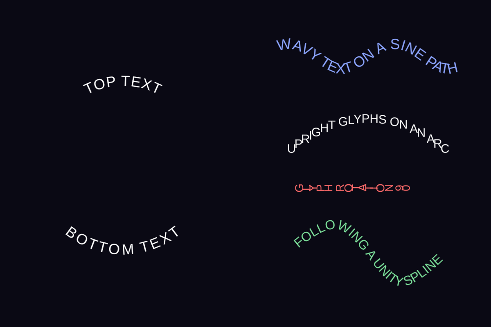

# TMP Text On Path

Makes any **TextMesh Pro** text follow a configurable path, similar to Figma's *Text on Path*.
Works with `TextMeshPro` (3D) and `TextMeshProUGUI` (UI), in Play mode and in Edit mode.

## Installation

- **Local package**: *Window > Package Manager > + > Install package from disk…*, then select `package.json`.
- **Or** copy the `TMPTextOnPath` folder into `Assets/`.

Requirements: Unity 2021.3+ with TextMesh Pro (part of `com.unity.ugui` since Unity 6) and the *TMP Essential Resources* imported.
Optional: `com.unity.splines` 2.0+ enables the `Spline` path mode (detected automatically).

## Usage

1. Add the **Text On Path (TMP)** component to a GameObject that has a TextMesh Pro component, or use
   *GameObject > Text On Path > Text On Path (3D / UI)*.
2. On the TMP component, set *Wrapping* to *Disabled* for single-line text.
3. Configure the path in the Inspector or directly in the Scene view:
   - the **yellow dot** slides the text along the path (*Start Offset*);
   - the **blue square** moves the path (*Path Offset*);
   - the **blue dots** set the radius (circle, arc) or the half-axes (ellipse);
   - in **Bezier** mode, white squares are the points and red dots their tangents.

*GameObject > Text On Path > Circular Badge (UI)* creates two texts sharing one circle (top text plus a readable bottom text).

## Settings

### Path

| Setting | Description |
|---|---|
| Shape | `Circle`, `Ellipse`, `Arc`, `Line`, `Wave`, `Curve` (AnimationCurve), `Bezier`, `Reference` or `Spline` |
| Radius / Radii | Radius of the circle and arc, half-axes of the ellipse |
| Start Angle | Start angle in degrees (0 = right, 90 = top) |
| Sweep Angle | Angular extent of the arc |
| Clockwise | Direction of travel |
| Length | Length of the line, wave or curve |
| Amplitude / Wavelength / Phase | Shape of the sine wave |
| Height + Curve | Free profile: X from 0 to 1 along the length, Y × height |
| Points / Closed | Cubic Bezier spline, open or closed |
| Reference Text | `Reference` mode: reuses the path of another Text On Path, live, whatever the relative transforms. Each text keeps its own offset, alignment and style. |
| Spline Container / Spline Index | `Spline` mode: follows a Unity Splines spline, projected onto the text's local XY plane |
| Path Offset / Path Rotation | Position and rotation of the path in the text's local space (applied on top of Reference and Spline paths) |
| Resolution | Number of samples used to approximate the path |

### Text

| Setting | Description |
|---|---|
| Offset Mode | `Normalized` (0..1 along the path) or `Distance` (local units) |
| Start Offset | Position of the anchor point along the path. On a closed path the value wraps around: animate it to scroll or rotate the text. |
| Alignment | The text starts (`Start`), is centered (`Center`) or ends (`End`) at the anchor point |
| Vertical Anchor | Which part of the text lies on the path: `Baseline`, `Middle`, `Top`, `Bottom` |
| Vertical Offset | Distance between the path and the text, along the normal |
| Reverse | Traverses the path backwards: the text moves to the other side and stays readable |
| Orientation | `FollowPath` (glyphs rotated along the tangent) or `Upright` (glyphs stay vertical) |
| Glyph Rotation | Extra rotation applied to every glyph, in degrees |
| Mirror Glyphs X / Y | Mirrors each glyph horizontally or vertically |
| Stretch To Fit / Fit Range | Spreads the characters so the text covers a fraction of the path |
| Overflow | On an open path: continue in a straight line (`Extrapolate`) or hide (`Hide`) characters past the ends |

Every setting is exposed as a C# property (`textOnPath.Radius = 300f;`, `textOnPath.Shape = PathShape.Wave;`, …).
Changes are detected automatically, including changes made by an Animator. Call `Refresh()` to apply them immediately.

## Recipes

| Effect | Settings |
|---|---|
| Text around the top of a circle | `Circle`, Start Angle 90, Clockwise, Start Offset 0, Alignment `Center` |
| Readable text at the bottom of the same circle | Second text: `Reference` to the first, Start Offset 0.5, `Reverse`, Vertical Anchor `Top`, negative Vertical Offset |
| Text running around the whole circle | `Stretch To Fit`, Fit Range 1 |
| Rotating text | Animate Start Offset from 0 to 1 on a closed path |
| Scrolling ticker on a curve | Offset Mode `Distance`, Overflow `Hide`, animate Start Offset |
| Mirrored copy (e.g. Figma flipped duplicate) | Same path, Mirror Glyphs X |
| Outline-only text | TMP material: Face alpha 0, Outline enabled |

## How it works and limitations

- Each character is moved and rotated as a rigid block, so the TMP material (outline, glow, underlay, gradients)
  and rich text (`<color>`, `<size>`, `<sprite>`…) are preserved.
- Glyphs are not bent individually: on a very tight curve, large letters stay straight.
- Underline and strikethrough (`<u>`, `<s>`) do not follow the path.
- Multi-line text is supported: subsequent lines are offset along the normal.
- With TMP *Mobile* shaders (the default material in Unity 6), the outline only renders when the `OUTLINE_ON`
  keyword is enabled on the material (*Outline* toggle in the material inspector).
